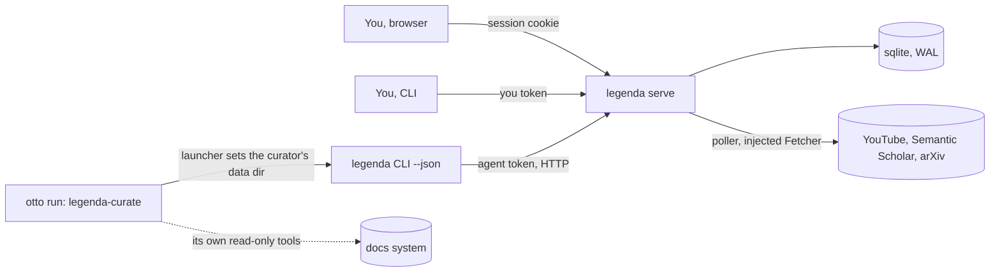

# legenda — architecture

Last checked against: `36ebea7` on 2026-11-13

## Purpose and boundaries

A personal "what to watch or read next" list for videos, papers and internal docs, for one
person per instance. The app polls what you follow and stores, dedupes and enforces; once a day
the curator skill, run by otto, adds a few finds with reasons and learns from your reactions.

**Out of scope:** AI inside the app; credentials for private systems (the agent reads docs with
its own tools); writing to any source; storing page bodies, PDFs or video; more than one user per
instance; sync between instances (`PLAN.md` §12).

## Components and data flow



| Component | Where | Does |
|---|---|---|
| CLI | `src/cli.ts`, `src/commands/`, `src/client.ts` | `serve`, `service`, `token`, `login` run locally; every other command is one HTTP call |
| Server | `src/server/server.ts` | Bun.serve: web bundle at "/", the JSON API, an event stream for open browsers |
| Request guard | `src/server/hostCheck.ts` | Host/Origin check before every route except "/", whose page bundle carries no data and is served unguarded (`src/server/server.ts`); self-contained to copy |
| API router | `src/server/api.ts`, `src/server/routes/` | Routes marked user-only or agent-only are refused in one place |
| Background | `src/server/background.ts` | Polls due follows every 5 min, expires stale intake, daily backup |
| Data layer | `src/db/` | Schema, migrations, auth, caps, events; writes run in one transaction |
| Pure core | `src/core/` | Parsing, the envelope and exit codes (`src/core/errors.ts`), the agent contract text |
| Sources | `src/sources/` | One adapter per source behind one interface; disabled sources are invisible |
| Web app | `src/web/` | React 19, bundled by Bun from `src/web/index.html` |
| Service | `src/local/service.ts` | launchd agent per instance (macOS) |
| Curator skill | `skills/legenda-curate/SKILL.md`, `skills/legenda-curate/check.sh` | All judgement; check script wakes it only when the queue runs low |
| Installer | `install.sh` | bun install + bun link, optionally the service |

## Where state lives

| State | Where | Survives a crash? | Backed up? |
|---|---|---|---|
| The database (items, follows, tokens, sessions, settings incl. API keys, events) | legenda.db in the data directory (`--dir`, else LEGENDA_DIR, else ~/.legenda; `src/config.ts`) | yes: WAL, busy timeout 5 s | daily VACUUM INTO backups/, integrity-checked, newest 14 kept (`src/db/backup.ts`) |
| The CLI's server URL and token | client.json in the data directory the CLI runs with | n/a (written once by `legenda login`) | no |
| Server log (service only) | logs/serve.log in the data directory; the plist in ~/Library/LaunchAgents (`src/local/service.ts`) | n/a | no |

Instances share nothing: each is its own data directory and port. Migrations are an append-only
numbered list in `src/db/database.ts`, applied in order in one transaction each and recorded in
PRAGMA user_version. A failing migration rolls back its own transaction; there are no down
migrations, so undoing a bad one means restoring a daily backup.

## Trust boundaries

Auth is attribution, not a security boundary (`src/db/auth.ts`): a token names an actor, the
server enforces what that actor may do, and every write records it.

| Actor | Gets in by | Can | Can't |
|---|---|---|---|
| You | `you` token (CLI) or a session cookie got by trading a `you` token in the browser | everything except the agent-only routes | start runs, suggest, add found docs, move cursors (agent-only); issue tokens over HTTP (no endpoint) |
| Agent (curator) | `agent:<name>` token in its own client.json, set by its otto launcher | read all but settings; start/finish runs, suggest, add found docs, decide intake, move agent-fed cursors, edit the profile with a note under a size cap; all capped and idempotent. Also, uncapped: force a poll of every app-polled follow, due or not (`src/server/routes/poll.ts`); fill empty fields of any item, such as links you pasted (enrich, `src/server/routes/curator.ts`) | add by hand, done, dismiss, restore, feedback, follow/unfollow/block, interests, read or change settings, sign in to the web app, issue tokens |
| Anyone with shell access as you | `legenda token <actor>` opens the database directly | issue any token | (outside the model: same user) |
| The network | binds 127.0.0.1 unless the listen_host setting says otherwise; Host must be a loopback name with our port or in allowed_hosts; writes with a foreign Origin get 403 | reach the API only with a token or cookie | DNS-rebind or reach it from another device unless allowed |

Secrets on disk: tokens and API keys in the database, a token in client.json. The data directory
and backups/ are 0700, the database, -wal, -shm, backups and client.json 0600; `legenda serve`
tightens looser ones on start (`src/db/fileModes.ts`, self-contained to copy). API keys are never
returned by any endpoint (I14). The logs/ directory is not in the set `legenda serve` tightens.

## Invariants

| # | Invariant | Enforced by |
|---|---|---|
| I1 | An agent token is refused every user-only command with exit 2, and nothing changes | `tests/e2e/m2-list-by-hand.test.ts`: "every user-only command is refused with exit 2, and changes nothing" |
| I2 | An agent token can't read or change settings | `tests/e2e/m5-curator-api.test.ts`: "an agent cannot read or change settings" |
| I3 | Only a `you` token can sign in to the web app | `tests/e2e/m3-web.test.ts`: "a browser signs in with a you token and gets a session cookie" |
| I4 | Only agents suggest or add what they found | `tests/e2e/m5-curator-api.test.ts`: "only agents suggest"; `tests/e2e/m8-docs.test.ts`: "only agents add what they found" |
| I5 | Tokens are issued only on the server machine, never over HTTP | **unenforced:** true by absence of an endpoint; no test asserts it |
| I6 | Adding a known item changes nothing; a dismissed item is never resurrected | `tests/e2e/m5-curator-api.test.ts`: "is idempotent: a known item returns existing and costs no cap"; `tests/e2e/m2-list-by-hand.test.ts`: "a dismissed item is never resurrected by adding it again" |
| I7 | The server enforces the curator's caps (daily, per source, per creator per run) | `tests/e2e/m5-curator-api.test.ts`: "the daily cap, overall and per source", "at most N per creator per run" |
| I8 | Every change is an event recording its actor | `tests/e2e/m2-list-by-hand.test.ts`: "every change is an event, attributed" |
| I9 | With --json, success and failure are one JSON envelope on stdout; exit codes 0–4 | `tests/e2e/m1-add-list.test.ts`: describe "the envelope and exit codes" (exit 3 in "show finds an item by id prefix or URL") |
| I10 | Every example in `legenda agents` runs as documented | `tests/e2e/contract.test.ts`: "every example in a contract with all three sources runs as documented" |
| I11 | A foreign Host, or a write with a foreign Origin, gets 403 before any route but "/" (the page bundle, no data) | `tests/e2e/r2-host-origin.test.ts`: "a request for a foreign host is refused with 403, naming the host and allowed_hosts", "a POST with a foreign Origin is refused with 403" |
| I12 | With no listen_host set, the server binds 127.0.0.1 only | `tests/e2e/r2-file-modes.test.ts`: "with no listen_host set, legenda serve listens on 127.0.0.1 only" |
| I13 | Data files are private, and serve tightens looser ones | `tests/e2e/r2-file-modes.test.ts`: "a new data directory, database, -wal and -shm are created private", "after legenda serve starts on a data dir with 0644 files, the dirs are 0700 and the files 0600" |
| I14 | API keys are stored but never echoed | `tests/e2e/m5-curator-api.test.ts`: "keys are stored but never echoed" |
| I15 | Every legenda command the skill uses exists | `tests/unit/skill.test.ts`: "every legenda command it uses exists" |
| I16 | One backup a day, pruned to the newest | `tests/unit/service.test.ts`: "daily backups: one a day, pruned to the newest" |
| I17 | Tests never reach the network | **unenforced:** `tests/helpers/fakeWeb.ts` fails on unknown URLs, but only for code that uses the injected Fetcher; nothing catches a direct `fetch`. The m4 test "no test reaches the network" checks only what FakeWeb itself recorded, so it can't fail |
| I18 | Tests never touch the real data directory | **unenforced:** the preload `tests/setup.ts` points LEGENDA_DIR at a temp dir; no test asserts it |
| I19 | Migrations are append-only; a shipped one is never edited | **unenforced:** a comment in `src/db/database.ts`; candidate for a schema guard test |
| I20 | `src/core/` is pure (no fs, db, randomness, React), except that `nowIso` in `src/core/time.ts` reads the clock | **unenforced:** a convention in `PLAN.md` and `README.md`; candidate for an import check |
| I21 | No AI in the app | **unenforced:** no model SDK in `package.json` today; nothing stops one being added |

## Decisions

The design record is `PLAN.md` (principles, data model, contract, milestones); it isn't repeated here.

- 2026-09-27 · Bun + sqlite, JSON CLI over HTTP, actors with tokens, no AI in the app · taken from omnifactum's conventions; legenda is now the template the others copy · `PLAN.md` §1–2, 8f830e2
- 2026-09-27 · The agent reads private docs with its own tools; the app holds no credentials · keeps work secrets out of the app · `PLAN.md` §1, §9
- 2026-10-03 · Retry YouTube feeds, prefer the Data API when a key is set · the public feed flakes · bb763a3, 96e06e1
- 2026-10-21 · A check script wakes the curator only when the queue is low · skip needless runs · 10b4106
- 2026-10-24 · Bind 127.0.0.1 by default, Host/Origin check, private data files (R2) · LAN and DNS-rebinding exposure; copied from otto's check_request · 6127959, 49a8431
- 2026-10-24 · The curator gets its own client directory via an otto launcher · a shared client.json made your commands run as the curator · 21c2a98

## Family

legenda is the reference map: lectio and omnifactum follow this map's shape and record only how
they differ. The shared design (JSON CLI and exit codes 0–4, actor tokens, local server with the
Host/Origin check, one sqlite file with append-only migrations, a skill run by otto) is in
`~/workspace/architect/FAMILY.md`.

## How to verify a change

Rung 1 on the verifiability ladder (`~/workspace/architect/VISION.md`): unit and e2e tests run
with one command, and the architect-build red/green workflow (new tests run against the base
commit in a throwaway worktree) works here. Half of rung 2 exists: `tests/helpers/instance.ts`
starts a real server on a free port against a temp database with seeded fixtures and drives the
real CLI, but only inside the test suite, and nothing drives the web app in a browser. No
evidence script (rung 3).

```bash
bun install --frozen-lockfile
bun run test            # typecheck + the whole suite (166 tests at 36ebea7)
```

## Unverified

- The user's running instances: actual listen_host, allowed_hosts, ports, which sources are on,
  and whether the curator's launcher is set up as the README describes.
- The curator skill's behaviour in a real otto run (only its command names and text are tested).
- The launchd service on a real machine (`tests/unit/service.test.ts` checks the plist and
  install calls, not launchd itself).
- That a failed migration leaves the database usable: no migration beyond the first exists yet.
- The web app's screens: only serving, sign-in, the event stream and history data are tested.
